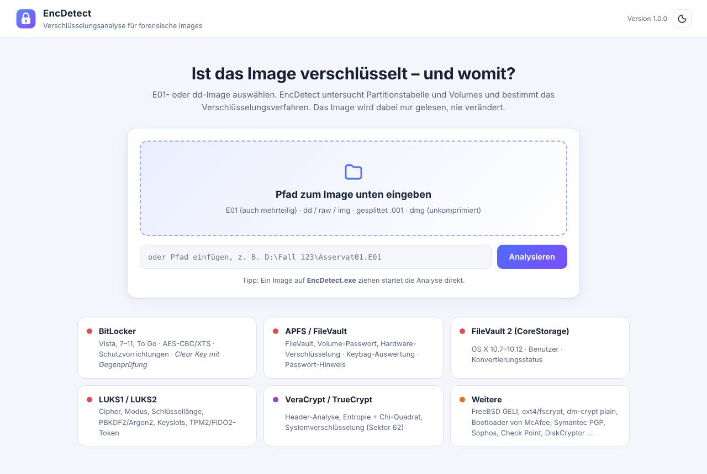
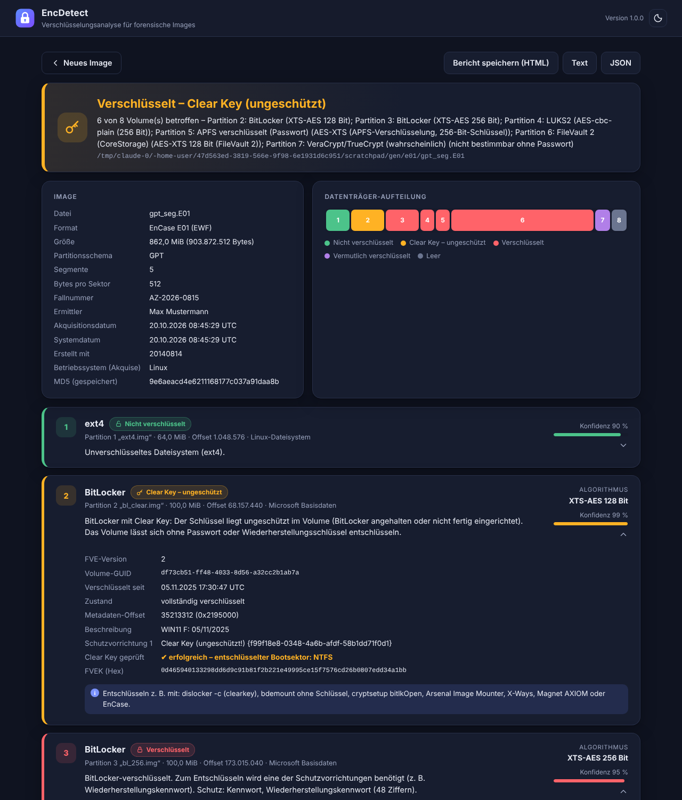

# EncDetect

Erkennt, ob ein forensisches Datenträger-Image (**E01** oder **dd/raw**) verschlüsselt ist, und bestimmt das Verfahren – soweit es die Metadaten hergeben. Eine einzelne Windows-EXE ohne Installation, mit grafischer Oberfläche und Kommandozeilenversion. Das Image wird ausschließlich lesend geöffnet.



## Erkannte Verschlüsselung

| Verfahren | Was ausgewertet wird |
|---|---|
| **BitLocker** (Vista – 11, To Go) | AES-CBC 128/256 (mit/ohne Elephant-Diffuser), XTS-AES 128/256, Zustand, „nur belegter Speicherplatz“, Schutzvorrichtungen (TPM, PIN, Kennwort, Wiederherstellungskennwort, Systemstartschlüssel, Smartcard), Wiederherstellungskennwort-ID |
| **BitLocker Clear Key** | Erkennung **und kryptografische Gegenprüfung**: VMK und FVEK werden mit dem ungeschützten Schlüssel entschlüsselt, der umgelagerte Bootsektor wird testweise entschlüsselt |
| **APFS** | FileVault, Volume-Passwort (externe Laufwerke/DMG), Hardware-Verschlüsselung (T2/Apple Silicon) über Container- und Volume-Keybags, Entsperr-Benutzer, Wiederherstellungsschlüssel, Passwort-Hinweis |
| **FileVault 2 (CoreStorage)** | OS X 10.7 – 10.12: Benutzer, Algorithmus, Konvertierungsstatus |
| **LUKS1 / LUKS2** | Cipher, Modus, Schlüssellänge, PBKDF2/Argon2, Keyslots, TPM2/FIDO2/Clevis-Token |
| **VeraCrypt / TrueCrypt, dm-crypt plain** | Statistisch (Entropie + Chi-Quadrat), zufälliger Header-Sektor, Systemverschlüsselung (Sektor 62). Der Algorithmus ist ohne Passwort grundsätzlich nicht bestimmbar. |
| **Weitere** | FreeBSD GELI, ext4 + fscrypt, verschlüsselte Einzeldateien (PGP/GPG, OpenSSL, age), Bootloader-Kennungen (McAfee, Symantec PGP, Sophos, Check Point, DiskCryptor, BestCrypt, SecureDoc …) |



## Unterstützte Image-Formate

- EnCase **E01** (auch mehrteilig E01/E02/…, EnCase 5–7, FTK, ewfacquire) – eigener EWF-Leser, keine libewf nötig
- **dd / raw / img / bin**, gesplittete Images (`.001`, `.002`, …), unkomprimierte DMG
- Partitionstabellen: GPT (512 B und 4K), MBR inkl. erweiterter Partitionen, unpartitionierte Volume-Images

Nicht unterstützt: Ex01, VMDK, VHDX, AFF – vorher in E01 oder dd umwandeln.

## Verwendung

**Oberfläche:** `EncDetect.exe` starten und ein Image auswählen oder **per Drag & Drop in das Fenster ziehen** (bei mehrteiligen E01 alle Segmente E01, E02, … gemeinsam markieren). Alternativ das Image auf die EXE ziehen. Bericht als HTML, Text oder JSON speichern. Benötigt Windows 10/11 (WebView2); ohne WebView2 öffnet sich die Oberfläche im Standardbrowser.

**Kommandozeile:**

```
encdetect-cli.exe D:\Fall\Asservat.E01
encdetect-cli.exe -json D:\Fall\Asservat.E01 > ergebnis.json
encdetect-cli.exe -html bericht.html D:\Fall\Asservat.E01
```

Fertige EXE-Dateien gibt es unter **Releases** bzw. als Artefakt jedes Build-Laufs.

## Selbst bauen

Go ≥ 1.24, kein CGO nötig – der Windows-Build funktioniert auch von Linux/macOS aus:

```
GOOS=windows GOARCH=amd64 CGO_ENABLED=0 go build -ldflags "-s -w -H windowsgui" -o EncDetect.exe ./cmd/encdetect
GOOS=windows GOARCH=amd64 CGO_ENABLED=0 go build -ldflags "-s -w" -o encdetect-cli.exe ./cmd/encdetect-cli
```

Icon, Manifest und Versionsinfo liegen in `cmd/encdetect/winres/` und werden mit [go-winres](https://github.com/tc-hib/go-winres) in `rsrc_windows_amd64.syso` übersetzt (`go run github.com/tc-hib/go-winres@v0.3.3 make --arch amd64` im Ordner `cmd/encdetect`).

## Aufbau

```
cmd/encdetect       GUI (WebView2-Fenster, lokaler HTTP-Server nur auf 127.0.0.1 mit Zufallstoken)
cmd/encdetect-cli   Kommandozeile
internal/image      E01-/RAW-Leser
internal/detect     Partitionen, BitLocker, APFS, CoreStorage, LUKS, GELI, Entropie
internal/report     Text-, JSON- und HTML-Bericht
internal/gui        Server, Windows-Dialoge, Web-Oberfläche
```

## Getestet mit

- 18 BitLocker-Images aus dem cryptsetup-Testbestand (alle Algorithmen, To Go, Clear Key, Startup Key, Smartcard)
- FileVault-2-, VeraCrypt- und TrueCrypt-Testimages von cryptsetup (93 VeraCrypt/TrueCrypt-Images)
- APFS-Images (verschlüsselt/unverschlüsselt) aus [dfvfs](https://github.com/log2timeline/dfvfs)
- LUKS1/LUKS2, ext4/fscrypt sowie mit ewfacquire erzeugte E01-Images (EnCase 5/6/7, FTK, mehrteilig) – MD5-identisch zum Rohimage

## Hinweise

„Vermutlich verschlüsselt“ ist eine statistische Aussage: Mit Zufallsdaten überschriebene oder stark komprimierte Bereiche sehen ähnlich aus. Das Tool knackt keine Passwörter und umgeht keine Verschlüsselung; es liest nur Metadaten (und nutzt bei BitLocker-Clear-Key den ungeschützt abgelegten Schlüssel zur Gegenprüfung).

## Lizenz

[MIT](LICENSE) – freie Nutzung, Veränderung und Weitergabe (auch kommerziell), solange der Copyright-Hinweis erhalten bleibt. Ohne Gewährleistung.
